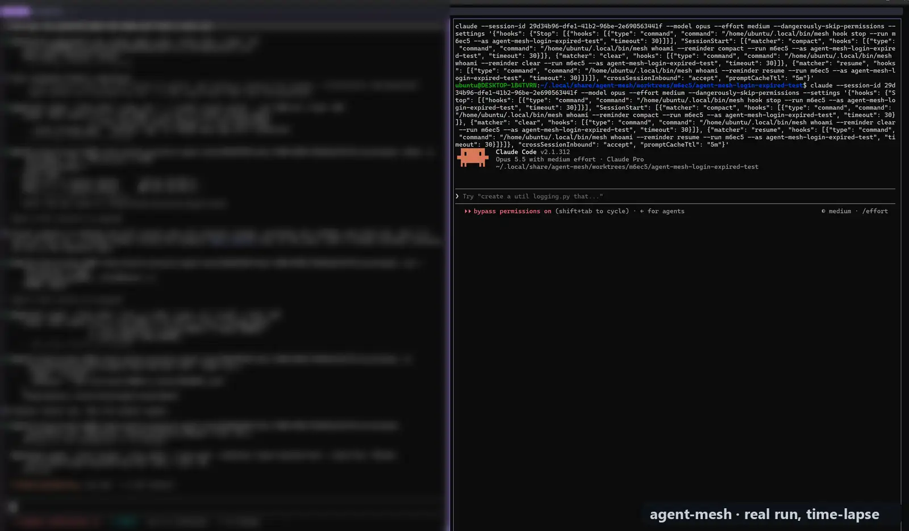
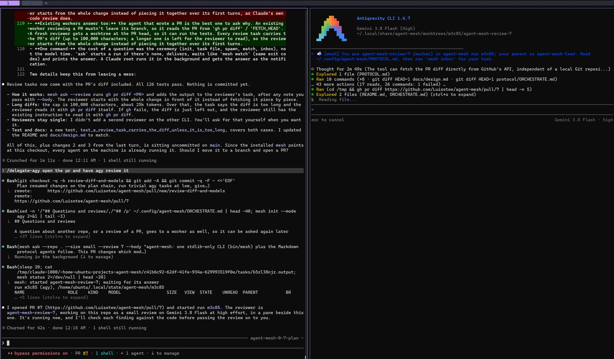

# agent-mesh

**Your coding agent hands work to agents that live in your other repos, then reviews what they send back.**

[](LICENSE)


Not a framework or an agent harness: a small daemon, a CLI and a few skills that let the Claude Code or [Antigravity](https://antigravity.google) session you already use start, brief and supervise other sessions, each one inside the repo it changes. A desktop app and an Android app show the same runs and let you step in. Requires GitHub and Linux or WSL.


<sub>A real run of the herdr-based predecessor, sped up about 50×: a worker fixes a hanging test and opens [PR #84](https://github.com/Luisotee/agent-mesh/pull/84), then a reviewer checks it below. The daemon runs the same procedure in terminals it hosts itself.</sub>

You're building a feature in `shop-web` and find that `shop-api` doesn't return the field you need. Usually you either stop and brief a new session in `shop-api` from scratch, or let your current agent edit a repo whose `CLAUDE.md`, hooks and conventions it never loaded. With agent-mesh you stay where you are and type:

```
/delegate shop-api should return `restockedAt` on GET /products/:id; shop-web needs it for the "back in stock" badge
```

1. **A root agent proposes the work** (which repo, task size, model) and waits for your go. A question or a review you asked for just runs.
2. **A worker starts inside `shop-api`,** in its own git worktree and its own terminal. It loads that repo's rules, skills and hooks.
3. **It researches and sends a plan.** The root reviews it (right files, right contract, real tests) and approves it or sends it back. Nothing is edited before approval.
4. **The same agent does the work,** in the same conversation, switched to its execution model, so no research is lost in a hand-off. It runs the repo's tests, lint and build, then opens a PR.
5. **Reviewers read the PR:** Claude, Gemini (agy), Copilot or OpenCode, one on a small PR (OpenCode's free models first), two on a large one (a free model, then a Claude reviewer, or agy when Claude wrote the PR); the PR's size picks how many reviewers, its risk how strong they are, and a risky PR of any size gets a relay of reviewers, one after another, each inside the repo at the PR's head. The worker that wrote the PR asks the round itself, checks each finding, fixes what holds up and reports what it declined, so the root reads one report per PR (a relay for a risky PR stays with the root).
6. **You get one report** with the PR link, what changed and the checks that passed. Meanwhile your session kept building the badge.

```
the root (a daemon agent, started by /delegate or the app)     keeps you in the loop
 └── shop-api-restocked-at   (claude)          research ─▶ plan ─▶ approved ─▶ code ─▶ test ─▶ PR
     │                                                   plans on a strong tier, executes on mid
     └── shop-api-review-88-agy  (agy, read-only)  asked by the worker: reviews the PR, reports findings
```

## Quick start

You need Linux or WSL with systemd user services, [Go](https://go.dev) (the installer builds the daemon), git, GitHub with [`gh`](https://cli.github.com) logged in, and [Claude Code](https://claude.com/claude-code) or the [Antigravity CLI](https://antigravity.google) (`agy`) or both.

> [!WARNING]
> Workers run with `--dangerously-skip-permissions`, so they can run any command on your machine without asking. What holds them: each works only in its own git worktree on a `mesh/<run>/<slug>` branch, read-only agents (askers, reviewers, and planners before approval) run under a deny list (no edits, no publishing), and workers are told to push only their own branch and open a PR, never to merge or deploy. Use it on repos and machines where that is acceptable, or turn the `skip_permissions` setting off (`mesh set --key skip_permissions --value false`) and answer the prompts in the agent's terminal yourself.

```bash
git clone https://github.com/Luisotee/agent-mesh
agent-mesh/install.sh          # builds and starts the daemon, links mesh and the skills; --uninstall reverses it
```

`install.sh` builds `meshd`, `mesh-term` and `mesh` into `~/.local/lib/agent-mesh`, starts the daemon as a systemd user service (its state is in `~/.local/state/agent-mesh-daemon`), links `mesh` into `~/.local/bin`, and adds the skills and a short rules block to the global files of the CLIs it finds. Re-run it after a `git pull` to upgrade, or to refresh the `PATH` the daemon's units hold. If you had the earlier `bin/mesh` install it replaces its links, and leaves its run state alone.

Then ask for something in another repo, from Claude Code or agy:

```
/delegate in ../shop-api, return restockedAt on GET /products/:id
```

Claude Code users can also take the skills from the plugin marketplace (`/plugin marketplace add Luisotee/agent-mesh`; the skills are then namespaced, `/agent-mesh:delegate`); `install.sh` is still needed for the daemon and CLI. Without the daemon running (`systemctl --user is-active agent-mesh`) the skills can't start a mesh.

### The apps

The **desktop app** (`desktop/`, Electron) and the **Android app** (`android/`) are clients of the same daemon: they list the runs and agents, show an agent's terminal, answer plans and questions, and change settings, on this machine or on another one you pair. On the host, `mesh pair --name "my phone"` prints the one-time link a device redeems; a self-hosted relay (`docs/relay.md`) reaches a host that has no open port. Both are built from their folders (`desktop/README.md`, `android/README.md`).

## Ways to use it

You don't have to type the commands: agents use these skills on their own when a request fits ("have the shop-api agent add `restockedAt`", "get Gemini's opinion on this PR").

### Change or ask about another repo, without leaving yours

| You say | What happens |
|---|---|
| `/delegate add rate limiting to the webhook route in notifications-service` | A worker in that repo plans, gets approved, codes, tests and opens a PR. |
| `/delegate how does shop-api compute restockedAt, and is it ever null?` | A read-only agent in that repo answers. Ask it again later and it still has what it read. |
| `/delegate send the review on shop-api#88 to the agent that made that PR` | That worker's conversation is reopened, with its research, and it updates the same PR. |

### Let Claude direct cheaper models on your other subscriptions

A root can hand the work to agy, so the planning and reviewing happen on Claude while the typing happens on Gemini, billed to your Google subscription:

```
/delegate with agy: add tests for the date parser in shop-web and admin-web
```

The root picks each worker's CLI, model and effort by the task: a tier (`light`, `mid`, `strong`) says how strong, and the pools differ in size (Claude is big, agy's plan small and kept for a second family or for relieving Claude, OpenCode's free models first for the work they do well). An agy worker's `strong` tier plans on the strongest model that still has quota. The tiers are settings (`mesh settings --prefix tiers`): yours to change. The daemon reads Claude's and agy's quotas, moves a worker that hits one to the next model, and by default starts nothing new on a vendor once its quota is 90% used.


<sub>A Claude root opens a PR and has agy review it (the herdr-based predecessor): the reviewer starts on Gemini Flash beside the root, in its own worktree.</sub>

### Work through a backlog

Keep a running `TODO.md`, add to it as things come up, and when a batch has piled up hand over the whole list:

```
/delegate work through TODO.md
```

The root sorts it into a few themed groups, shows you a board (which worker takes what, in which repo, on which model) and waits for your one go. Then as many workers run in parallel as the host carries (`caps.working`, sized from its cores), one PR per group, each PR reviewed, and the findings go back to the worker that wrote it. You come back to a table of PRs with a suggested merge order. The root writes no code itself, so its context stays small however long the list is.

### Reviews from several vendors

```
/delegate-review 88           # PR #88 by the reviewers its size calls for
/delegate-review all 88       # by every installed CLI
```

Each reviewer works inside the repo at the PR's head and changes nothing. You get one merged list of findings, each checked against the code, with who found it.

### Learn from projects like yours

`/find-peers` searches GitHub and the web for open-source projects that share your repo's core mechanisms, ranks them by overlap rather than stars, and on your yes clones and registers each one as a peer. `/harvest-peers` then asks them all at once (a fresh read-only asker each, on free models first) for ideas and bugs you may have, checks every finding in your code, and files the survivors in your tracker on your yes.

### Skills that work on their own

- **`/check-plan`** checks a plan you or your agent wrote against the code: verifies its claims, finds the strongest objection, gives a verdict and fixes the plan. Every mesh worker runs it before sending a plan.
- **`/make-concise`** rewrites a repo's `CLAUDE.md` / `AGENTS.md` in concise plain English without dropping a rule, with a validator that fails on anything lost.

## Why agent-mesh

- **Agents work inside the repo, not from outside it.** Each worker follows the target repo's own instructions, hooks and skills.
- **You can watch and step in.** Every agent runs in a terminal the daemon hosts; the apps attach to it, and what you type there overrides the agent that started it.
- **Plan first, then the same agent executes.** Large tasks plan on the tier the root picks and get reviewed before any code changes; approval reopens the *same conversation* on the execution tier the root names. Small tasks skip the plan. A later "think about it" (research, options, a rewrite, an optimisation) sends a worker back into planning in the same conversation (`mesh send --type task --plan`, or "Plan first" in the desktop's message dialog), on a strong tier or a higher effort; Claude workers plan in Claude Code's own plan mode.
- **Claude, Gemini, Copilot and OpenCode as reviewers and workers in one run** (each as far as its adapter goes), with a PR reviewed by several vendors at once.
- **Supervised, not fire-and-forget.** Every message is stored before a doorbell wakes the recipient, so a missed doorbell loses nothing. The daemon flags an agent that went silent, exited, sits at a dialog or hit a quota.

## What it costs

Every worker and reviewer is a full Claude Code or agy session drawing on your own subscription, so a large task with two reviewers is three or more sessions. agent-mesh keeps that down:

- **Effort by size:** a translation or a one-line fix goes straight to a PR with no plan, on a light model; every PR is reviewed by its author first, then by one outside reviewer on a small PR and two on a large one, in one round.
- **Lean sessions:** Claude agents start without the tools, skills, plugins and MCP servers a mesh agent rarely needs (about 39k tokens that every call would re-read), with session flags only, never your settings; an agent that needs one adds it back with `mesh tools add`, and the root passes a worker the servers its task needs (`--mcp playwright`).
- **Idle workers are closed** 5 minutes after they report, and reopened in the same conversation when you need them again, compacted first if they grew large (sooner once their prompt cache has gone cold); a big planner is compacted at approval, and a big worker before a follow-up.
- **One machine's memory:** each worker gets a share of the cores (`worker_cpus`), so the test suites it runs start fewer workers; reviewers read the PR's CI before running tests; and no agent starts while memory runs short or the machine thrashes.
- **A quota reserve:** it plans on the best model with quota left, the root moves an agy worker that hits a quota to the next model (a Claude worker is continued at the reset), and by default nothing new starts on a quota window once it is 90% used. The five-hour and weekly windows have a reserve each (`quota_stop`, `quota_stop_weekly`), and an optional reviews-only line per CLI (`quota_reviews_only.claude`, `.agy`, off by default) keeps a nearly spent CLI for PR reviews.
- **`mesh cost`** shows the tokens each agent of a run used, by phase, model and effort, for Claude, agy and OpenCode (cache reads apart), with Claude's API-equivalent dollars beside them; its review rows are per model and effort too.
- **`mesh usage`** shows each plan's windows with their pace (a warning when use runs ahead of the clock) and, once the daemon has measured them from its own readings, what is left of each in one unit ("≈ 3% of a Claude week").

## How it compares

| | agent-mesh | [Claude Code agent teams](https://code.claude.com/docs/en/agent-teams)\* | Headless runs (`claude -p`, MCP bridges) | Raw tmux scripts (`send-keys`) |
|---|---|---|---|---|
| Each worker runs inside the repo it changes | yes | in the lead's project | yes | yes |
| You can watch and type into workers | yes | yes | no | yes |
| Claude and Gemini in one run | yes | Claude only | depends on the bridge | depends |
| Plans reviewed before code | by the root, or by you | approved by the lead | no | no |
| A message is stored before the agent is woken | yes | yes | n/a | no |
| Reopen the worker that wrote a PR, in a later run | yes | no | no | no |

\* As of October 2026.

[`docs/design.md`](docs/design.md) explains each decision and the alternatives that lost, including what similar projects ran into.

## Make it yours

Every default (what each tier runs per CLI, reviewers per PR size, review rounds, the quota reserve, the lean-session lists) is a setting in the daemon's table: `mesh settings` prints each value and where it came from, `mesh set --key <key> --value <value>` changes it, and the apps' settings screen is generated from the same table.

## Docs

- [`daemon/README.md`](daemon/README.md): the daemon's reference: layout, installing, behaviour, settings, the protocol.
- [`docs/apps.md`](docs/apps.md): the plan and decisions for the daemon and the apps.
- [`docs/design.md`](docs/design.md): why the mesh works this way (it records the `bin/mesh` era, whose decisions still hold where `docs/apps.md` doesn't say otherwise).
- [Protocol](daemon/share/protocol/PROTOCOL.md): the rules every agent in a mesh follows. The root's and workers' procedure is [`ORCHESTRATE.md`](daemon/share/protocol/ORCHESTRATE.md).

## Development

```bash
daemon/scripts/check.sh       # buf, gofmt, vet, go test -race and the Python suite; desktop/ and android/ have their own check.sh
uvx pytest -q tests           # install.sh, the plugin, the rules files; go, systemctl and herdr are stubbed
```

## License

[PolyForm Noncommercial 1.0.0](LICENSE): free for personal use, hobby projects and research, and for charitable organizations, educational institutions, public research, safety, health or environmental organizations and government institutions. Any commercial use, including use inside a company and selling or reselling it, needs a commercial license: contact [@Luisotee](https://github.com/Luisotee). This is a summary: the LICENSE text governs. Commits up to f73ee32 (2026-11-25) remain under the MIT License.
