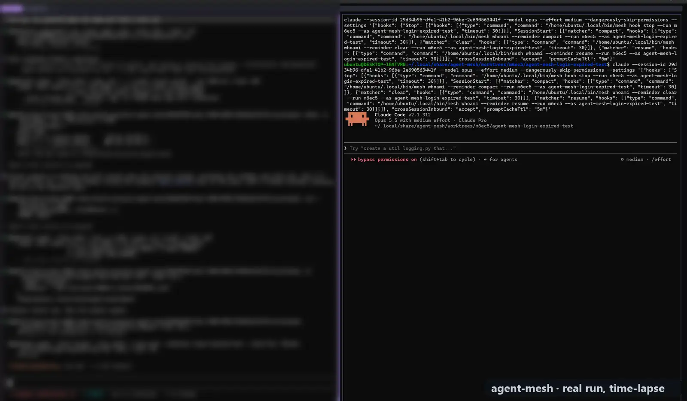
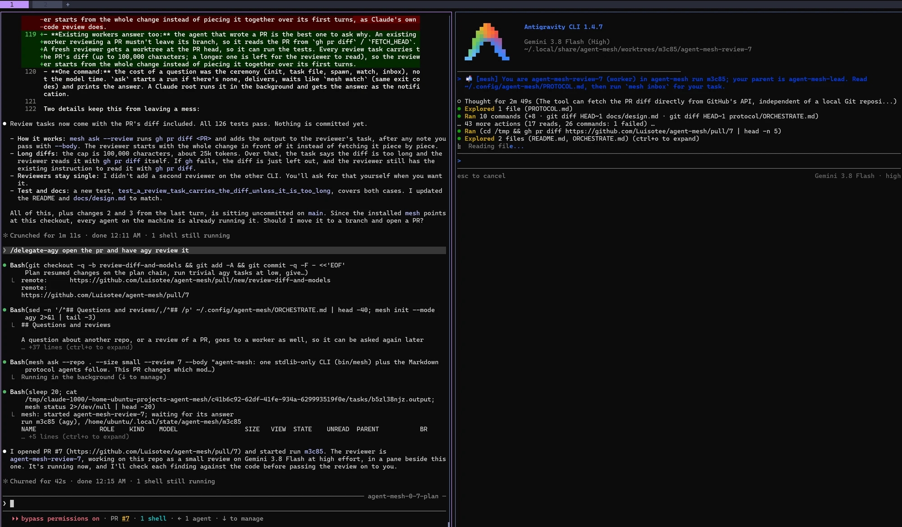
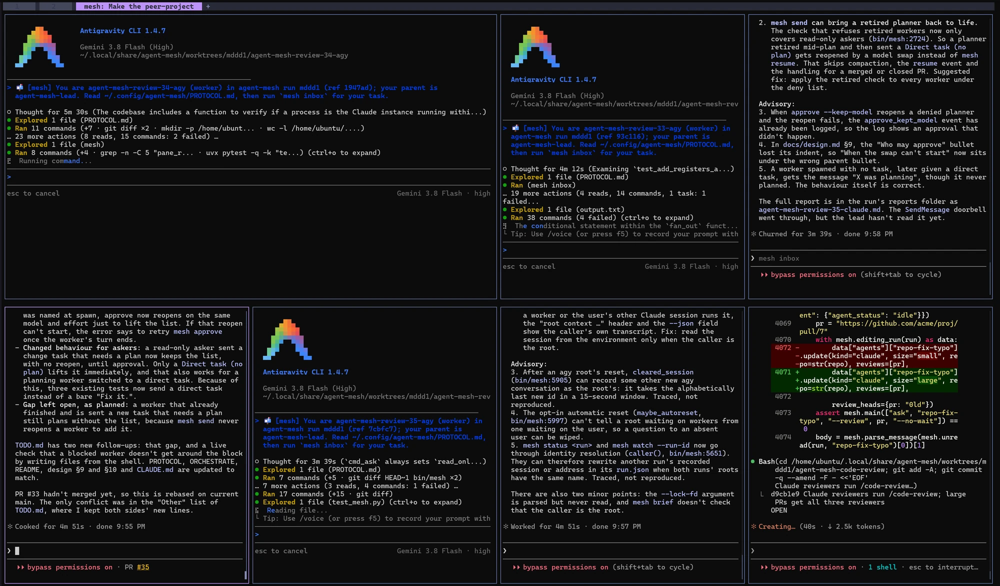

# agent-mesh

**Your coding agent hands work to agents that live in your other repos, then reviews what they send back.**

[](LICENSE)


Not a framework or an agent harness: a small CLI and a few skills that let the Claude Code or [Antigravity](https://antigravity.google) session you already use start, brief and supervise other sessions, each one inside the repo it changes. Requires [herdr](https://herdr.dev), GitHub and Linux or WSL.


<sub>A real run, sped up about 50×: a worker fixes a hanging test and opens [PR #84](https://github.com/Luisotee/agent-mesh/pull/84), then a reviewer checks it in the pane below.</sub>

You're building a feature in `shop-web` and find that `shop-api` doesn't return the field you need. Usually you either stop and brief a new session in `shop-api` from scratch, or let your current agent edit a repo whose `CLAUDE.md`, hooks and conventions it never loaded. With agent-mesh you stay where you are and type:

```
/delegate-claude shop-api should return `restockedAt` on GET /products/:id; shop-web needs it for the "back in stock" badge
```

1. **Your session proposes the work** (which repo, task size, model) and waits for your go. A question or a review you asked for just runs.
2. **A worker starts inside `shop-api`,** in its own git worktree, in a terminal pane next to yours. It loads that repo's rules, skills and hooks.
3. **It researches and sends a plan.** Your session reviews it (right files, right contract, real tests) and approves it or sends it back. Nothing is edited before approval.
4. **The same agent does the work,** in the same conversation, switched to its execution model, so no research is lost in a hand-off. It runs the repo's tests, lint and build, then opens a PR.
5. **Reviewers read the PR:** Claude, Gemini (agy) or Copilot, picked by the PR's size, each inside the repo at the PR's head. Findings go back to the worker that wrote it.
6. **You get one report** with the PR link, what changed and the checks that passed. Meanwhile your session kept building the badge.

```
your session in shop-web (root)                     keeps building the badge
 ├── shop-api-restocked-at   (claude, pane)    research ─▶ plan ─▶ approved ─▶ code ─▶ test ─▶ PR
 │                                                         plans on Opus, high   executes at medium
 └── shop-api-review-88-agy  (agy, read-only)  reviews the PR, reports findings
```

## Quick start

You need [herdr](https://herdr.dev) (your session runs in a herdr pane), [Claude Code](https://claude.com/claude-code) or the [Antigravity CLI](https://antigravity.google) (`agy`) or both, GitHub with [`gh`](https://cli.github.com) logged in, Linux or WSL, Python 3.10+ and git. The [Copilot CLI](https://github.com/github/copilot-cli) is optional, as a reviewer.

> [!WARNING]
> Workers run with `--dangerously-skip-permissions`, so they can run any command on your machine without asking. What holds them: each works only in its own git worktree on a `mesh/<run>/<slug>` branch, Claude planners and reviewers run under a deny list (no edits, no push), while agy has none and its planners are held only by their instructions; and workers are told to push only their own branch and open a PR, never to merge or deploy. Use it on repos and machines where that is acceptable, or set `"skip_permissions": false` in the [config](docs/guide.md#configuration) and answer the prompts yourself.

```bash
git clone https://github.com/Luisotee/agent-mesh
agent-mesh/install.sh          # symlinks the CLI, protocol and skills; --uninstall reverses it
```

Then open your repo in a herdr pane, start `claude` (in bypass-permissions mode, or you approve each worker's report as it arrives) or `agy`, and ask for something in another repo:

```
/delegate-claude in ../shop-api, return restockedAt on GET /products/:id
```

Claude Code users can also take the skills from the plugin marketplace (`/plugin marketplace add Luisotee/agent-mesh`); `install.sh` is still needed for the CLI, and the plugin's skills are namespaced (`/agent-mesh:delegate-claude`). The [guide](docs/guide.md#install) covers what `install.sh` touches, the plugin, desktop notifications, and running with only one of the CLIs.

## Ways to use it

You don't have to type the commands: agents use these skills on their own when a request fits ("have the shop-api agent add `restockedAt`", "get Gemini's opinion on this PR").

### Change or ask about another repo, without leaving yours

| You say | What happens |
|---|---|
| `/delegate-claude add rate limiting to the webhook route in notifications-service` | A worker in that repo plans, gets approved, codes, tests and opens a PR. |
| `/delegate-claude how does shop-api compute restockedAt, and is it ever null?` | A read-only agent in that repo answers. Ask it again later and it still has what it read. |
| `/delegate-claude send the review on shop-api#88 to the agent that made that PR` | That worker's conversation is reopened, with its research, and it updates the same PR. |

### Let Claude direct cheaper models on your other subscriptions

Your Claude Code session can be the root and hand the work to agy, so the planning and reviewing happen on Claude while the typing happens on Gemini, billed to your Google subscription:

```
/delegate-agy add tests for the date parser in shop-web and admin-web
```

agy workers plan on the strongest model that still has quota (Argon, then Claude Opus through agy, then Flash) and execute on Gemini Flash. Copilot can take reviews on your GitHub plan. mesh reads Claude's and agy's quotas, plans on the best model with quota left, and by default starts nothing new on a quota once it is 90% used. Which model does what is [yours to set](docs/guide.md#configuration).


<sub>A Claude root opens a PR and has agy review it: the reviewer starts on Gemini Flash in a pane beside the root, in its own worktree.</sub>

### Work through a backlog

Keep a running `TODO.md`, add to it as things come up, and when a batch has piled up hand over the whole list:

```
/delegate-claude work through TODO.md
```

The root sorts it into a few themed groups, shows you a board (which worker takes what, in which repo, on which model) and waits for your one go. Then up to four workers run in parallel, one PR per group, each PR reviewed, and the findings go back to the worker that wrote it. You come back to a table of PRs with a suggested merge order. The root writes no code itself, so its context stays small however long the list is.

### Reviews from several vendors

```
/delegate-review all 88       # PR #88 by Claude, agy and Copilot at once
/delegate-review copilot      # the current branch's PR, by Copilot
```

Each reviewer works inside the repo at the PR's head and changes nothing. You get one merged list of findings, each checked against the code, with who found it.

### Learn from projects like yours

`/find-peers` searches GitHub and the web for open-source projects that share your repo's core mechanisms, ranks them by overlap rather than stars, and on your yes clones each one with a standing read-only agent that keeps its context between questions. `/harvest-peers` then asks them all at once for ideas and bugs you may have, checks every finding in your code, and files the survivors in your tracker on your yes.

### Skills that work on their own

- **`/check-plan`** checks a plan you or your agent wrote against the code: verifies its claims, finds the strongest objection, gives a verdict and fixes the plan. Every mesh worker runs it before sending a plan.
- **`/make-concise`** rewrites a repo's `CLAUDE.md` / `AGENTS.md` in concise plain English without dropping a rule, with a validator that fails on anything lost.

## Why agent-mesh

- **Agents work inside the repo, not from outside it.** Each worker follows the target repo's own instructions, hooks and skills.
- **You can watch and step in.** Workers are live interactive sessions: a herdr pane, or a Claude Code background session you can attach to (`mesh open`). What you type into one overrides the agent that started it.
- **Plan first, then the same agent executes.** Large tasks plan on the strongest model with quota left and get reviewed before any code changes; approval reopens the *same conversation* on the execution model. Small tasks skip the plan.
- **Claude, Gemini and Copilot in one run.** Mix Claude Code and agy workers, and have a PR reviewed by several vendors at once.
- **Supervised, not fire-and-forget.** Every message is stored in a mailbox before a doorbell wakes the recipient, so a missed doorbell loses nothing. While the root waits, a watchdog flags a worker that went silent, sits at a dialog, hung, crashed or hit a quota.


<sub>One run: agy reviewers on Gemini Flash beside Claude workers, each in its own worktree, reporting back to the root.</sub>

No server or database to install: one stdlib Python script, a few skills and a protocol written in Markdown, with state in plain files.

## What it costs

Every worker and reviewer is a full Claude Code or agy session drawing on your own subscription, so a large task with two reviewers is three or more sessions. agent-mesh keeps that down:

- **Effort by size:** a translation or a one-line fix goes straight to a PR with no plan; a tiny PR is reviewed by the root alone, a small one by one reviewer in one round.
- **Idle workers are closed** 15 minutes after they report, and reopened in the same conversation when you need them again, compacted first if they grew large.
- **A quota reserve:** it plans on the best model with quota left, the root moves an agy worker that hits a quota to the next model (a Claude worker is continued at the reset), and by default nothing new starts on a quota once it is 90% used.
- **`mesh cost`** shows what each agent of a run spent, by phase.

## How it compares

| | agent-mesh | [Claude Code agent teams](https://code.claude.com/docs/en/agent-teams)\* | Headless runs (`claude -p`, MCP bridges) | Raw tmux scripts (`send-keys`) |
|---|---|---|---|---|
| Each worker runs inside the repo it changes | yes | in the lead's project | yes | yes |
| You can watch and type into workers | yes | yes | no | yes |
| Claude and Gemini in one run | yes | Claude only | depends on the bridge | depends |
| Plans reviewed before code | by the root, or by you | approved by the lead | no | no |
| A message is stored before the agent is woken | yes | yes | n/a | no |
| Reopen the worker that wrote a PR, in a later run | yes | no | no | no |

\* As of October 2026.

[`docs/design.md`](docs/design.md) explains each decision and the alternatives that lost, including what similar projects ran into.

## Make it yours

Every default (models and efforts per task size, reviewers per PR size, review rounds, the quota reserve, where your repos live) is a setting in an optional `~/.config/agent-mesh.json`, and `mesh routing` prints each value and where it came from. See [Configuration](docs/guide.md#configuration).

## Docs

- [Guide](docs/guide.md): every command, the sizes and models, reviews, task lists, follow-ups, the watchdog's exit codes, safety rails, requirements and configuration.
- [Design notes](docs/design.md): why it works this way.
- [Protocol](protocol/PROTOCOL.md): the rules every agent in a mesh follows. The root's and workers' procedure is [`ORCHESTRATE.md`](protocol/ORCHESTRATE.md).

## Development

```bash
uvx pytest -q tests       # herdr and the agent CLIs are stubbed; git worktree tests use real temp repos
```

## License

[MIT](LICENSE).
